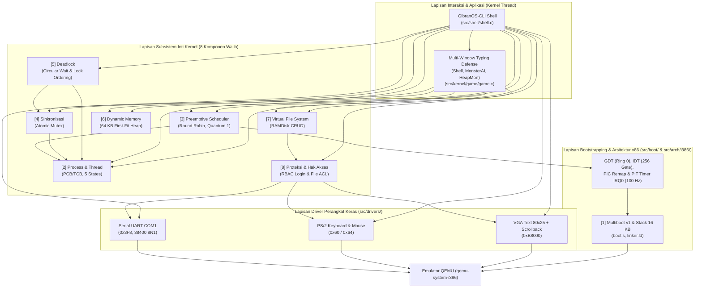

# LAPORAN TUGAS BESAR SISTEM OPERASI
## PERANCANGAN DAN IMPLEMENTASI MINI-OS KERNEL x86 32-BIT: **GIBRANOS**

> **Catatan Draf:** Lengkapi bagian bertanda `[...]` (Nama, NIM, Kelas, Dosen, serta tangkapan layar QEMU) sebelum mengonversi dokumen ini ke format `.docx` / `.pdf`. Panjang dokumen ini dirancang sesuai ketentuan **10–15 halaman** di luar lampiran.

---

### Identitas Kelompok
* **Nama Sistem Operasi:** GibranOS v0.1.2 (x86 32-bit Bare-Metal Mini-OS)
* **Mata Kuliah:** Sistem Operasi
* **Dosen Pengampu:** `[Nama Dosen Pengampu]`
* **Kelas / Tahun Akademik:** `[Kelas / 2026]`
* **Anggota Kelompok:**
  1. `[Nama Anggota 1]` — `[NIM]` *(Bootstrapping, CLI Shell, & Virtual File System)*
  2. `[Nama Anggota 2]` — `[NIM]` *(Alokator Memori Dinamis & Device Drivers)*
  3. `[Nama Anggota 3]` — `[NIM]` *(Pengelolaan Proses/Thread & Penjadwalan CPU Preemptive)*
  4. `[Nama Anggota 4]` — `[NIM]` *(Sinkronisasi, Deadlock, & Proteksi Hak Akses)*

---

## BAB I: PENDAHULUAN

### 1.1 Deskripsi Singkat GibranOS dan Fitur Utamanya
**GibranOS** adalah sistem operasi *bare-metal* sederhana (*Mini-OS*) berbasis arsitektur **x86 32-bit (Protected Mode)** yang dibangun dari awal (*from scratch*) tanpa bergantung pada *standard library* maupun sistem operasi *host* (`-ffreestanding -nostdlib`). Kernel GibranOS mengikuti standar spesifikasi **Multiboot v1** sehingga dapat dimuat langsung ke memori fisik RAM dan dijalankan di atas emulator perangkat keras **QEMU (`qemu-system-i386`)**.

GibranOS dirancang untuk memenuhi seluruh capaian pembelajaran mata kuliah Sistem Operasi dengan mengimplementasikan delapan komponen inti secara terintegrasi:
1. **Bootstrapping & Antarmuka CLI Kernel (`GibranOS-CLI`):** Memuat kernel ke alamat fisik `1 MB`, menampilkan logo ASCII *booting*, menyediakan layar teks VGA `80x25` dengan *scrollback history* 200 baris, serta menerima input secara simultan dari **Keyboard PS/2**, **Mouse Scroll**, dan **Terminal Serial UART COM1**.
2. **Pengelolaan Proses & Thread:** Mengelola proses dan *kernel thread* melalui struktur *Process Control Block* (`pcb_t`) dan *Thread Control Block* (`tcb_t`) dengan siklus hidup 5 status penuh (*NEW, READY, RUNNING, WAITING, TERMINATED*).
3. **Penjadwalan CPU Preemptive:** Menggunakan algoritma **Preemptive Round Robin** yang dipicu oleh interupsi perangkat keras *Programmable Interval Timer* (PIT IRQ0, frekuensi 100 Hz, *time quantum* 1 tick) dengan mekanisme *context switching* nyata di level register Assembly.
4. **Sinkronisasi Antar-Thread:** Mengimplementasikan **Mutex** berbasis instruksi atomik (`__atomic_test_and_set` / `__atomic_clear`) dengan mekanisme pemblokiran thread (`PROCESS_WAITING`) untuk melindungi *shared data* dari *race condition*.
5. **Skenario & Penanganan Deadlock:** Menyediakan demonstrasi nyata dua thread yang mengalami *circular wait* terhadap dua mutex (`mutex_score` dan `mutex_vfs`), dilengkapi pendeteksian *wait-for graph*, pemulihan (*recovery*), serta solusi pencegahan menggunakan **Lock Ordering**.
6. **Alokator Memori Dinamis (Kernel Heap):** Mengelola area Heap sebesar **64 KB** menggunakan algoritma **First-Fit** dengan *4-byte alignment*, pemecahan blok (*splitting*), penggabungan blok bebas (*coalescing*), dan penanganan *Out of Memory* (OOM) secara aman tanpa menyebabkan *kernel crash*.
7. **Virtual File System (VFS) Berbasis RAMDisk:** Menyediakan sistem berkas di memori RAM hingga 16 berkas teks (masing-masing maksimal 2048 byte) dengan dukungan penuh operasi **CRUD** (*Create, Read, Update, Delete*) serta berkas sistem bawaan `words.txt` dan `scores.txt`.
8. **Proteksi & Hak Akses:** Menerapkan kontrol hak akses berbasis peran (**Role-Based Access Control / RBAC**) melalui gerbang autentikasi (*GibranOS Security Gateway*) yang membedakan peran `USER` dan `ADMIN` baik pada perintah CLI maupun pada tiga tingkat proteksi berkas VFS (`[USER]`, `[PUBLIC]`, `[PROTECTED]`).

Sebagai pembuktian integrasi seluruh subsistem kernel, GibranOS juga menghadirkan aplikasi interaktif **Multi-Window Game Typing Defense** (`game`) yang menjalankan tiga *kernel thread* paralel (`Shell`, `MonsterAI`, dan `HeapMon`) sembari memvisualisasikan alokasi memori Heap dan pergantian konteks *Round Robin* secara langsung di layar VGA.

### 1.2 Bahasa Pemrograman, Toolchain, dan Lingkungan Pengujian
Pengembangan dan pengujian GibranOS menggunakan perangkat lunak berikut:

| Kategori | Komponen | Peran dalam Proyek |
| :--- | :--- | :--- |
| **Bahasa Pemrograman** | **Assembly x86 (NASM)** | *Multiboot v1 header*, inisialisasi *stack* awal (`boot.s`), pemuatan GDT (`gdt_flush.s`), serta *Interrupt Service Routine* untuk *context switching* (`timer_irq.s`). |
| **Bahasa Pemrograman** | **C (Freestanding)** | Seluruh logika inti kernel, driver perangkat keras, manajemen proses/memori/sinkronisasi/VFS/keamanan, CLI shell, dan aplikasi game. |
| **Assembler** | **NASM** | Mengompilasi berkas Assembly `.s` menjadi objek ELF 32-bit (`-f elf32`). |
| **Compiler & Linker** | **Clang (LLVM) & LLD (`ld.lld`)** | Kompilasi silang target `i386-pc-none-elf` dengan flag `-ffreestanding -mno-sse -mno-mmx -O2 -Wall -Wextra` dan penautan `-nostdlib` sesuai `src/boot/linker.ld`. |
| **Build Automation** | **GNU Make** | Mengotomatiskan kompilasi objek, penautan `build/kernel.bin`, dan eksekusi QEMU via `Makefile`. |
| **Emulator Pengujian** | **QEMU (`qemu-system-i386`)** | Mengemulasi mesin x86 32-bit lengkap dengan VGA Text Mode (`0xB8000`), PS/2 Keyboard & Mouse (`0x60`/`0x64`), PIC 8259A, PIT 8253/8254, dan Serial UART 16550 COM1 (`0x3F8`). |

---

## BAB II: RANCANGAN DAN IMPLEMENTASI

### 2.1 Diagram Arsitektur Mini-OS
GibranOS dibangun dengan arsitektur berlapis (*layered monolithic kernel*) yang memisahkan lapisan *bootstrapping* & arsitektur perangkat keras, lapisan *driver* I/O, lapisan subsistem inti kernel (8 komponen utama), hingga lapisan interaksi pengguna (CLI Shell dan Aplikasi Multi-Window Game).



### 2.2 Komponen 1: Bootstrapping & Antarmuka CLI Kernel
* **Berkas terkait:** `src/boot/boot.s`, `src/boot/linker.ld`, `src/arch/i386/gdt.c`, `src/arch/i386/gdt_flush.s`, `src/arch/i386/idt.c`, `src/kernel/main.c`, `src/shell/shell.c`, `src/drivers/keyboard.c`, `src/drivers/mouse.c`, `src/drivers/serial.c`.

#### A. Mekanisme Bootstrapping & Peta Memori
1. **Multiboot Header (`src/boot/boot.s`):** Mendefinisikan konstanta standar Multiboot v1 (`MAGIC = 0x1BADB002`, `FLAGS = 0x03`, `CHECKSUM = -(MAGIC + FLAGS)`) pada seksi `.multiboot` agar QEMU mengenali `build/kernel.bin` sebagai kernel 32-bit yang valid.
2. **Linker Script (`src/boot/linker.ld`):** Menempatkan alamat muat kernel pada alamat fisik **`1 MB` (`0x00100000`)** untuk menghindari area BIOS dan memori video VGA (`0xA0000–0xFFFFF`), dengan urutan seksi `.text` (diawali `*(.multiboot)`), `.rodata`, `.data`, dan `.bss`.
3. **Inisialisasi Stack & Entry Point:** Seksi `.bss` menyediakan *stack* awal sebesar **16 KB** (`stack_bottom` ke `stack_top`). Label `_start` mengarahkan register `esp` ke `stack_top` lalu memanggil `kernel_main()`.

#### B. Urutan Inisialisasi Kernel (`kernel_main`)
Di dalam `src/kernel/main.c`, interupsi dimatikan sementara (`cli`), kemudian kernel menginisialisasi seluruh subsistem secara berurutan:
1. `vga_clear(0x07)` — membersihkan layar VGA (`0xB8000`) dan *scrollback history* 200 baris.
2. `gdt_init()` & `idt_init()` — memasang Global Descriptor Table (3 entri: Null, Kernel Code `0x08`, Kernel Data `0x10`) dan Interrupt Descriptor Table (256 entri).
3. `timer_init()` — me-remap PIC 8259A dan mengonfigurasi PIT saluran 0 pada frekuensi **100 Hz** (IRQ0 → INT 32).
4. `heap_init()`, `scheduler_init()`, `process_init()` — menyiapkan Heap 64 KB, antrean penjadwalan, dan tabel PCB/TCB.
5. `process_create("Shell", shell_task, 1, PRIVILEGE_KERNEL)` — membuat *kernel thread* utama untuk CLI Shell.
6. `keyboard_init()`, `mouse_init()`, `vfs_init()`, `serial_init()` — menginisialisasi perangkat I/O dan RAMDisk.
7. Menampilkan banner logo ASCII (`print_banner()`) dan status inisialisasi subsistem, lalu mengaktifkan interupsi (`sti`) dan memasuki loop idle `hlt` sehingga penjadwal otomatis menjalankan `shell_task`.

#### C. Antarmuka CLI Shell & Driver I/O
* **Tampilan VGA & Serial Mirroring:** Setiap keluaran pada `vga_putchar()` ditulis ke `history_buffer[200][80]` (mendukung gulir layar dengan panah `UP`/`DOWN`, `PGUP`/`PGDN`, dan roda gulir mouse) serta diteruskan ke port **Serial UART COM1 (`0x3F8`, 38400 8N1)** agar seluruh log juga terbaca di terminal serial QEMU (`-serial stdio`).
* **Pembacaan Perintah (`shell_run` & `shell_execute`):** Membaca karakter secara *non-blocking* dari `keyboard_poll_char()` (PS/2 scancode set 1 dengan dukungan `Shift` & `CapsLock`) maupun `serial_getchar()`. Setelah tombol `Enter` ditekan, `shell_execute()` mem-parsing perintah menggunakan `extract_token()` dan mengeksekusi perintah internal:
  * **Dasar:** `help`, `clear`, `version`, `echo <teks>`, `game`, `logout`, `shutdown`.
  * **Proses & Penjadwalan:** `ps`, `thread_test`, `schedtest`.
  * **Sinkronisasi & Deadlock:** `mutex_test`, `deadlock`, `deadlock_fix`.
  * **Memori Dinamis:** `meminfo`, `test_mem`.
  * **VFS & Keamanan:** `ls`, `create`, `read`, `update`, `delete`, `access_test`.

---

### 2.3 Komponen 2: Pengelolaan Proses & Thread
* **Berkas terkait:** `src/kernel/02_Pengelolaan_Proses_Thread/process.h`, `src/kernel/02_Pengelolaan_Proses_Thread/process.c`.

#### A. Struktur Data Utama
GibranOS menyediakan tabel statis hingga **`MAX_PROCESSES = 16`** dan **`MAX_THREADS = 16`**, dengan masing-masing thread memiliki *kernel stack* terpisah sebesar **`KERNEL_STACK_SIZE = 4096` byte** (perataan 16-byte).

```c
typedef enum {
    PROCESS_NEW = 0,
    PROCESS_READY,
    PROCESS_RUNNING,
    PROCESS_WAITING,
    PROCESS_TERMINATED
} process_state_t;

typedef struct tcb {
    uint32_t tid;
    process_state_t state;
    uint32_t esp;              /* Stack pointer saat konteks disimpan */
    uint32_t stack_base;
    uint32_t priority;
    uint32_t time_slice;
    uint32_t total_ticks;
    uint32_t switches;
    void*    waiting_on;       /* Pointer mutex yang sedang ditunggu */
    struct pcb* parent_process;
    struct tcb* next;
} tcb_t;

typedef struct pcb {
    uint32_t pid;
    char name[32];
    process_state_t state;
    privilege_level_t privilege;
    tcb_t* main_thread;
    uint8_t used;
} pcb_t;
```

#### B. Mekanisme Pembuatan & Transisi 5 Status Thread
1. **Inisialisasi Konteks Awal (`process_create_new`):** Dengan interupsi dimatikan sementara (`irq_save`), fungsi mencari slot proses/thread kosong (atau menggunakan ulang slot berstatus `PROCESS_TERMINATED` dengan nama sama agar demo dapat dijalankan berulang tanpa kehabisan slot). Pada puncak *stack* thread, dibentuk bingkai `cpu_context_t` awal dengan segmen kernel (`cs = 0x08`, `ds/es/fs/gs = 0x10`), `eip = entry_point`, dan `eflags = 0x202` (flag interupsi `IF = 1` aktif). Status awal ditetapkan sebagai **`PROCESS_NEW`** dan thread didaftarkan ke *linked-list* scheduler.
2. **Aktivasi (`process_start`):** Mengubah status dari **`NEW` → `READY`** agar dapat dipilih oleh penjadwal. Fungsi `process_create()` menggabungkan `process_create_new()` dan `process_start()`.
3. **Eksekusi & Pemblokiran (`RUNNING` ↔ `WAITING`):** Saat dipilih scheduler, status berubah menjadi **`RUNNING`**. Jika thread memanggil `mutex_lock()` pada kunci yang sedang dipakai, statusnya berubah menjadi **`WAITING`** dengan `waiting_on` menunjuk ke mutex terkait; saat dilepas (`mutex_unlock`), status kembali menjadi **`READY`**.
4. **Terminasi (`process_terminate`):** Mengubah status PCB dan TCB menjadi **`TERMINATED`** sehingga scheduler tidak lagi memilih thread tersebut.

---

### 2.4 Komponen 3: Penjadwalan CPU Preemptive
* **Berkas terkait:** `src/arch/i386/timer.c`, `src/arch/i386/timer_irq.s`, `src/kernel/03_Penjadwalan_CPU_Preemptive/scheduler.h`, `src/kernel/03_Penjadwalan_CPU_Preemptive/scheduler.c`.

#### A. Pemicu Interupsi Hardware (PIT IRQ0) & Low-Level Context Switching
Penjadwalan preemptive berjalan sepenuhnya oleh interupsi perangkat keras, bukan pemanggilan kooperatif atau simulasi teks:
1. **`timer_init()`** me-remap PIC master ke vektor 32–39, mengaktifkan IRQ0 (`outb(0x21, 0xFE)`), mendaftarkan `pit_irq_stub` di IDT vektor 32, dan memprogram PIT saluran 0 dengan pembagi `1193182 / 100` (**100 Hz**, 1 tick = 10 ms).
2. **`pit_irq_stub` (`timer_irq.s`):** Setiap kali interupsi IRQ0 terjadi, CPU otomatis mendorong `eflags`, `cs`, dan `eip` ke *stack* thread yang sedang berjalan. Stub Assembly kemudian:
   * Mendorong `error_code = 0`, `interrupt_number = 32`, seluruh register umum (`pusha`), dan register segmen (`ds`, `es`, `fs`, `gs`) sehingga tata letak *stack* cocok persis dengan `cpu_context_t`.
   * Mengirimkan nilai `esp` saat ini sebagai argumen ke fungsi C `pit_handler(uint32_t current_esp)`.
   * Memuat nilai kembalian `eax` (yaitu `next->esp` milik thread berikutnya) langsung ke register **`esp`** (`mov esp, eax`).
   * Memulihkan register segmen (`gs..ds`), register umum (`popa`), membersihkan 8 byte metadata, lalu mengeksekusi **`iretd`** untuk melompat ke `eip` dan `eflags` milik thread berikutnya.

#### B. Algoritma Round Robin (`scheduler_tick`)
```text
[IRQ0 100 Hz] -> pit_irq_stub (simpan konteks ke stack thread aktif)
                      |
                      v
               pit_handler(current_esp)
               - Simpan current->esp (selama bukan TERMINATED)
               - Panggil scheduler_tick():
                 * Jika thread aktif RUNNING:
                   time_slice++, total_ticks++
                   Jika time_slice >= SCHEDULER_QUANTUM (1 tick):
                       time_slice = 0; state = PROCESS_READY;
                 * scheduler_pick_next() memindai linked-list melingkar
                   mencari thread berstatus PROCESS_READY berikutnya.
                 * Jika ditemukan thread berbeda:
                   context_switch_count++, next->switches++
                   next->state = PROCESS_RUNNING
               - Kirim EOI (0x20) ke PIC master
               - Kembalikan next->esp ke pit_irq_stub -> mov esp, eax -> iretd
```
Nilai quantum dikelola secara terpusat melalui `SCHEDULER_QUANTUM` (bernilai `1` tick) dan diakses melalui `scheduler_get_quantum()` agar konsisten pada tampilan boot kernel dan UI monitor.

---

### 2.5 Komponen 4: Sinkronisasi
* **Berkas terkait:** `src/kernel/04_Sinkronisasi/mutex.h`, `src/kernel/04_Sinkronisasi/mutex.c`, `src/shell/shell.c` (`run_mutex_sync_demo`).

#### A. Struktur Data & Algoritma Mutex
```c
typedef struct {
    volatile uint8_t locked;      /* 0 = Terbuka, 1 = Terkunci */
    tcb_t*           owner;       /* Pemilik kunci saat ini */
    tcb_t*           wait_queue;  /* Referensi antrean tunggu */
} mutex_t;
```
* **`mutex_lock(mutex_t* m)`:**
  1. Mematikan interupsi sementara (`mutex_irq_save()`) sebelum menguji kunci untuk mencegah *lost wake-up* jika timer memotong di antara pengecekan kunci dan perubahan status menjadi `WAITING`.
  2. Menjalankan operasi atomik `__atomic_test_and_set(&m->locked, __ATOMIC_ACQUIRE)`. Jika kunci bebas, `m->owner` diisi thread aktif, status dipastikan `PROCESS_RUNNING`, interupsi dipulihkan, dan fungsi kembali.
  3. Jika kunci sedang dipegang thread lain, thread mencatat `current->waiting_on = (void*)m`, mengubah statusnya menjadi **`PROCESS_WAITING`**, memulihkan interupsi, lalu mengeksekusi `hlt` untuk menyerahkan CPU sampai dibangunkan.
* **`mutex_unlock(mutex_t* m)`:** Dalam kondisi interupsi mati, mengosongkan `m->owner`, melepas kunci melalui `__atomic_clear(&m->locked, __ATOMIC_RELEASE)`, lalu memindai tabel proses untuk membangunkan thread yang berstatus `PROCESS_WAITING` dengan `waiting_on == m` kembali ke **`PROCESS_READY`**.

#### B. Desain Skenario Uji Race Condition vs Mutex (`mutex_test`)
Dua thread nyata (`GameInput` dan `GameSave`) masing-masing melakukan 10 iterasi penambahan `shared_counter` sebesar `+10` (target total = `200`). Di antara pembacaan (`temp = shared_counter`) dan penulisan kembali (`shared_counter = temp + 10`), disisipkan jeda 2 tick PIT agar preemption Round Robin terjadi di tengah *read-modify-write*:
* **Fase 1 (Tanpa Mutex):** Kedua thread membaca nilai `shared_counter` yang sama sebelum salah satunya sempat menulis kembali, sehingga terjadi **lost update** (`hasil < 200`).
* **Fase 2 (Dengan Mutex):** Blok *read-modify-write* dibungkus `mutex_lock()` dan `mutex_unlock()`, menjamin *mutual exclusion* sehingga hasil selalu konsisten **`200 / 200`**.

---

### 2.6 Komponen 5: Deadlock
* **Berkas terkait:** `src/kernel/05_Deadlock/deadlock.h`, `src/kernel/05_Deadlock/deadlock.c`.

#### A. Mekanisme Demonstrasi Deadlock (`deadlock`)
Modul menyiapkan dua sumber daya bersama: `dl_mutex_score` (**R1**) dan `dl_mutex_vfs` (**R2**). Pada mode deadlock (`use_lock_ordering = 0`), dua thread nyata berjalan secara konkuren:
* **Thread `GameInput`:** Mengunci **R1** → menahan selama 60 tick (0,6 detik) → meminta **R2**.
* **Thread `GameSave`:** Mengunci **R2** → menahan selama 60 tick (0,6 detik) → meminta **R1**.

Urutan penguncian yang berlawanan ini memenuhi keempat **Kondisi Coffman** secara bersamaan:
1. **Mutual Exclusion:** Setiap mutex hanya dapat dimiliki satu thread pada satu waktu.
2. **Hold and Wait:** Masing-masing thread menahan satu mutex sembari menunggu mutex kedua.
3. **No Preemption:** Mutex tidak dapat direbut paksa oleh thread lain sebelum pemiliknya memanggil `mutex_unlock()`.
4. **Circular Wait:** `GameInput` menunggu `R2` milik `GameSave`, sementara `GameSave` menunggu `R1` milik `GameInput`.

Thread `Shell` bertindak sebagai pemantau *wait-for graph* melalui `dl_is_circular_wait(ta, tb)`. Bila kondisi *circular wait* bertahan melebihi `DL_CONFIRM_TICKS` (100 tick / 1 detik), kernel mengonfirmasi deadlock, mencetak log kejadian & tabel status thread (`STATE = WAITING`), lalu melakukan **recovery** (menghentikan kedua thread dengan `process_terminate()` dan mereset mutex) agar sistem CLI tetap responsif.

#### B. Solusi Pencegahan Deadlock (`deadlock_fix`)
Pada mode solusi (`use_lock_ordering = 1`), kernel menerapkan strategi **Lock Ordering (Pengurutan Pengambilan Kunci Global)**: seluruh thread diwajibkan selalu mengambil **R1 (`mutex_score`)** terlebih dahulu sebelum **R2 (`mutex_vfs`)**. Hal ini memutus syarat *Circular Wait* secara matematis; thread kedua yang terlambat akan masuk status `WAITING` pada R1 sampai thread pertama melepas R1 dan R2, lalu melanjutkan eksekusi hingga kedua thread berakhir pada status `TERMINATED`.

---

### 2.7 Komponen 6: Alokator Memori Dinamis
* **Berkas terkait:** `src/kernel/06_Alokator_Memori_Dinamis/heap.h`, `src/kernel/06_Alokator_Memori_Dinamis/heap.c`.

#### A. Struktur Data & Tata Letak Heap
Area memori dinamis kernel dialokasikan sebagai buffer statis **`heap_area[65536]` (64 KB)** dengan perataan 16-byte dan dikelola sebagai *singly linked-list* blok metadata:

```c
#define HEAP_SIZE 65536 /* 64 KB ruang Heap Kernel */

typedef struct heap_block {
    size_t             size; /* Ukuran payload blok (byte) */
    uint8_t            free; /* 1 = Kosong, 0 = Sedang dipakai */
    struct heap_block* next; /* Pointer ke blok berikutnya */
} heap_block_t;
```

#### B. Algoritma First-Fit, Splitting, Coalescing, & Penanganan OOM
1. **`heap_init()`:** Membentuk satu blok bebas tunggal berukuran `HEAP_SIZE - sizeof(heap_block_t)` di awal `heap_area`.
2. **`kmalloc(size_t size)` (Alokasi First-Fit):**
   * Mengembalikan `NULL` jika `size == 0`.
   * Meratakan `size` ke kelipatan 4 byte (`(size + 3) & ~3`).
   * Menelusuri `free_list` untuk menemukan blok pertama dengan `curr->free == 1` dan `curr->size >= size`.
   * **Block Splitting:** Jika sisa ruang mencukupi (`curr->size >= size + sizeof(heap_block_t) + 4`), blok dipecah menjadi blok terpakai sebesar `size` dan blok kosong baru di sisanya.
   * **Penanganan Out of Memory (OOM):** Jika tidak ada blok bebas yang mencukupi hingga akhir list, `kmalloc()` mengembalikan `NULL` secara terkendali tanpa merusak memori maupun menimbulkan *kernel crash*.
3. **`kfree(void* ptr)` (Pelepasan & Coalescing):**
   * Menghitung alamat header blok `(uint8_t*)ptr - sizeof(heap_block_t)` dan menandai `block->free = 1`.
   * **Coalescing:** Memindai `free_list` dan menggabungkan setiap dua blok bebas yang bersebelahan (`curr->size += sizeof(heap_block_t) + curr->next->size`) untuk mencegah fragmentasi eksternal.
4. **Inspeksi Memori:** `heap_get_free_bytes()` menghitung total byte bebas, sedangkan `heap_get_head()` membuka akses baca ke `free_list` untuk pemantauan blok secara langsung di Multi-Window Game.

---

### 2.8 Komponen 7: Virtual File System (VFS)
* **Berkas terkait:** `src/kernel/07_Virtual_File_System/vfs.h`, `src/kernel/07_Virtual_File_System/vfs.c`.

#### A. Struktur Data RAMDisk
VFS GibranOS menyimpan berkas di memori RAM melalui array `ramdisk[MAX_FILES]` dengan batas **`MAX_FILES = 16`**, **`MAX_FILENAME = 32`**, dan **`MAX_FILESIZE = 2048` byte**:

```c
typedef struct {
    char     name[MAX_FILENAME];
    char     data[MAX_FILESIZE];
    uint32_t size;
    uint8_t  in_use;
    uint8_t  is_protected; /* 0 = [USER], 1 = [PUBLIC], 2 = [PROTECTED] */
} ramdisk_file_t;
```

#### B. Operasi CRUD & Berkas Bawaan
* **`vfs_init()`:** Mengosongkan seluruh slot dan menginisialisasi dua berkas sistem bawaan berstatus `[PROTECTED]`: `words.txt` (kamus kosakata untuk Game Typing Defense) dan `scores.txt` (penyimpanan rekor skor tertinggi).
* **`vfs_create(name, content, is_protected)` (Create):** Memvalidasi nama berkas, menolak duplikasi (`VFS_ERR_EXISTS`), memeriksa ketersediaan slot (`VFS_ERR_FULL`), lalu menyimpan isi beserta level proteksinya.
* **`vfs_read(name, out_buffer)` (Read):** Mencari berkas (`VFS_ERR_NOT_FOUND`), memverifikasi izin baca lewat `security_check_access(is_protected, 0)`, lalu menyalin isi ke buffer keluaran.
* **`vfs_update(name, new_content)` (Update):** Memverifikasi izin tulis lewat `security_check_access(is_protected, 1)` sebelum menimpa isi dan memperbarui `size`. Fungsi internal `vfs_kernel_update()` disediakan khusus agar kernel/game dapat memperbarui `scores.txt`.
* **`vfs_delete(name)` (Delete):** Memverifikasi izin tulis/hapus, lalu mereset slot (`in_use = 0`) agar dapat digunakan kembali.
* **`vfs_list_files()` (`ls`):** Menampilkan daftar berkas aktif, ukuran dalam byte, label proteksi, dan jumlah slot terpakai.

---

### 2.9 Komponen 8: Proteksi & Hak Akses
* **Berkas terkait:** `src/kernel/08_Proteksi_Hak_Akses/security.h`, `src/kernel/08_Proteksi_Hak_Akses/security.c`, integrasi di `src/shell/shell.c` dan `src/kernel/07_Virtual_File_System/vfs.c`.

#### A. Model Kontrol Hak Akses (RBAC) & Security Gateway
Sesuai ketentuan tugas besar (*pemisahan user/kernel mode **atau** kontrol hak akses sederhana*), GibranOS menerapkan **Role-Based Access Control (RBAC)** dengan gerbang login wajib (`security_show_login_screen()`) sebelum masuk ke CLI Shell:
* **`ROLE_USER` (`user` / `user`):** Hak akses terbatas — hanya dapat mengakses menu dasar (`help`, `clear`, `version`, `echo`, `game`, `logout`, `shutdown`, `access_test`), melihat daftar berkas (`ls`), membaca berkas `[PUBLIC]`, serta melakukan CRUD penuh hanya pada berkas `[USER]`.
* **`ROLE_ADMIN` (`admin` / `admin123`):** Hak akses penuh ke seluruh fitur sistem (menu 1–8) dan seluruh tingkat proteksi berkas.

#### B. Mekanisme Penegakan Proteksi
1. **Proteksi Perintah Kernel (`security_require_admin`):** Setiap perintah sensitif (`ps`, `thread_test`, `schedtest`, `mutex_test`, `deadlock`, `deadlock_fix`, `meminfo`, `test_mem`) memanggil `security_require_admin()`. Jika peran aktif bukan `ROLE_ADMIN`, eksekusi langsung diblokir dan menampilkan `[ACCESS DENIED]`.
2. **Proteksi Berkas VFS (`security_check_access`):** Menggantikan fungsi *weak symbol* di `vfs.c` untuk menerapkan matriks izin 3 tingkat:

| Level Berkas VFS | Akses `ADMIN` | Akses `USER` (CLI) | Akses Internal Game |
| :--- | :--- | :--- | :--- |
| `VFS_PROT_USER (0)` — `[USER]` | Create, Read, Update, Delete | Create, Read, Update, Delete | Diizinkan |
| `VFS_PROT_PUBLIC (1)` — `[PUBLIC]` | Create, Read, Update, Delete | **Read saja** (Update/Delete ditolak) | Diizinkan |
| `VFS_PROT_PROTECTED (2)` — `[PROTECTED]` | Create, Read, Update, Delete | **Ditolak total** (`VFS_ERR_PROTECTED`) | Read `words.txt`/`scores.txt` diizinkan via flag CLI |

---

### 2.10 Integrasi Sistem: Aplikasi Multi-Window Game Typing Defense
* **Berkas terkait:** `src/kernel/game/game.c`, `src/kernel/game/game.h`.

Perintah `game` mengintegrasikan hampir seluruh modul kernel ke dalam antarmuka *Split-Screen Multi-Window TUI* pada layar VGA `80x25`:
* **Window 1 (Kolom 0–48):** Arena *Typing Defense* yang dikelola oleh thread **`Shell`** (input keyboard & render arena).
* **Window 2 (Kolom 49–79 atas):** *Live Heap Monitor* yang membaca `heap_get_head()` untuk menampilkan blok terpakai/bebas, persentase beban, dan delta memori secara langsung.
* **Window 3 (Kolom 49–79 tengah):** *Live Round Robin Monitor* yang menampilkan jumlah *context switch*, nilai `scheduler_get_quantum()`, dan status tiap thread.
* **Window 4 (Kolom 49–79 bawah):** Log real-time aktivitas `kmalloc`, `kfree`, dan transisi thread.

Game menjalankan 3 thread nyata secara paralel (**`Shell`**, **`MonsterAI`**, dan **`HeapMon`**) yang disinkronisasi menggunakan `g_game_mutex`. Fitur *Pause* (`TAB`) menghentikan `MonsterAI` murni dengan mengubah status TCB menjadi `PROCESS_WAITING` sehingga dilewati oleh `scheduler_pick_next()`. Seluruh data sesi, kamus kata dari `words.txt`, dan objek monster dialokasikan dinamis via `kmalloc()` dan dibebaskan seluruhnya via `kfree()` saat keluar (`ESC`).

---

## BAB III: PENGUJIAN DAN HASIL

Seluruh pengujian dilakukan pada emulator **QEMU (`qemu-system-i386 -kernel build/kernel.bin -serial stdio`)** setelah kompilasi dengan `make`.

### 3.1 Pengujian Modul 1: Bootstrapping & CLI Kernel
* **Skenario:** Menjalankan `make run`, memverifikasi tampilan *Security Gateway* & logo ASCII `GIBRANOS`, login sebagai `admin` (`admin123`), lalu menjalankan minimal 3 perintah CLI (`version`, `echo`, `help`, `clear`).
* **Log Keluaran:**
  ```text
  [AUTH] Login berhasil sebagai ADMINISTRATOR (Akses Penuh Menu 1-8).
  GibranOS-CLI [ADMIN] $ version
  GibranOS v0.1.2 (x86 32-bit Multiboot Kernel)
  GibranOS-CLI [ADMIN] $ echo Halo Penguji GibranOS!
  Halo Penguji GibranOS!
  GibranOS-CLI [ADMIN] $ help
  =====================================================================================
                           GIBRAN OS - DAFTAR PERINTAH
  ...
  ```
* **Bukti Screenshot:** `[SISIPKAN SCREENSHOT QEMU: Login Gateway, Banner ASCII, dan eksekusi version/echo/help]`
* **Status:** **BERHASIL** (boot lancar di QEMU, input Keyboard PS/2 & Serial UART berfungsi, >15 perintah CLI aktif).

### 3.2 Pengujian Modul 2: Pengelolaan Proses & Thread
* **Skenario:** Menjalankan perintah `thread_test` lalu `ps` untuk memverifikasi 2 *kernel thread* nyata (`GameInput` & `GameSave`) dengan tugas berbeda melewati seluruh 5 status (*NEW → READY → RUNNING → WAITING → TERMINATED*).
* **Log Keluaran:**
  ```text
  GibranOS-CLI [ADMIN] $ thread_test
  === [2] SIKLUS HIDUP 2 THREAD (NEW..TERMINATED) ===
  GameInput : Memantau tick waktu/input
  GameSave  : Membaca berkas scores.txt dari VFS

  1. Status Awal   -> GameInput: NEW | GameSave: NEW
  2. Dijadwalkan   -> GameInput: READY | GameSave: READY
  3. Eksekusi CPU  -> GameInput: RUNNING | GameSave: RUNNING
  4. Tunggu Gate   -> GameInput: WAITING | GameSave: WAITING
  5. Selesai Tugas -> GameInput: TERMINATED | GameSave: TERMINATED
  Hasil GameInput (Loop): <angka_tick> | GameSave (scores.txt): OK

  GibranOS-CLI [ADMIN] $ ps
  PID  NAME          STATE        TID  THREAD STATE  CPU TICKS
  1    Shell         RUNNING      1    RUNNING       ...
  2    GameInput     TERMINATED   2    TERMINATED    ...
  3    GameSave      TERMINATED   3    TERMINATED    ...
  ```
* **Bukti Screenshot:** `[SISIPKAN SCREENSHOT QEMU: Output perintah thread_test dan ps]`
* **Status:** **BERHASIL**.

### 3.3 Pengujian Modul 3: Penjadwalan CPU Preemptive
* **Skenario:** Menjalankan `schedtest` sebelum dan sesudah menjalankan perintah multithread (`thread_test`, `mutex_test`, atau `game`) serta mengamati peningkatan nilai `Context Switches` dan `CPU TICKS` pada `ps` serta Window 3 di dalam `game`.
* **Log Keluaran:**
  ```text
  GibranOS-CLI [ADMIN] $ schedtest
  === ROUND ROBIN SCHEDULER STATUS ===
  Algorithm       : PREEMPTIVE ROUND ROBIN
  Time Quantum    : 1 ticks
  Context Switches: <meningkat setiap giliran antar-thread>
  Info            : Jalankan 'ps' atau 'game' untuk memantau thread aktif.
  ```
* **Bukti Screenshot:** `[SISIPKAN SCREENSHOT QEMU: Output schedtest & tampilan WIN 3: ROUND ROBIN LIVE pada perintah game]`
* **Status:** **BERHASIL** (pergantian konteks berjalan nyata melalui IRQ0 PIT dan pertukaran `ESP`).

### 3.4 Pengujian Modul 4: Sinkronisasi (Race Condition vs Mutex)
* **Skenario:** Menjalankan `mutex_test` untuk membandingkan pembaruan `shared_counter` oleh `GameInput` dan `GameSave` (target `200`) tanpa mutex vs dengan mutex.
* **Log Keluaran:**
  ```text
  GibranOS-CLI [ADMIN] $ mutex_test
  === [4] PENGUJIAN SINKRONISASI (RACE CONDITION VS MUTEX) ===
  GameInput & GameSave menambah shared_counter (+10 x 10 tiap thread).
  Nilai target yang seharusnya: 200

  1. Tanpa Mutex : 100 / 200 (Race Condition / Lost Update)
  2. Dengan Mutex: 200 / 200 (Konsisten / Terlindungi Mutex)
  ```
* **Bukti Screenshot:** `[SISIPKAN SCREENSHOT QEMU: Output perintah mutex_test]`
* **Status:** **BERHASIL** (perbedaan *lost update* tanpa mutex dan konsistensi data dengan mutex terlihat jelas).

### 3.5 Pengujian Modul 5: Deadlock & Penanganannya
* **Skenario:**
  1. Menjalankan `deadlock` untuk mendemonstrasikan 2 thread saling terkunci (*circular wait*) dan verifikasi mekanisme deteksi + *recovery*.
  2. Menjalankan `deadlock_fix` untuk membuktikan pencegahan deadlock dengan **Lock Ordering** (`R1 -> R2`).
* **Log Keluaran:**
  ```text
  GibranOS-CLI [ADMIN] $ deadlock
  === [5] DEMONSTRASI DEADLOCK (CIRCULAR WAIT) ===
  ...
  [DEADLOCK!] Circular wait terdeteksi (bertahan > 1 detik):
    GameInput memegang R1, menunggu R2  --->  R2 dipegang GameSave
    GameSave  memegang R2, menunggu R1  --->  R1 dipegang GameInput
    THREAD     TID  STATE       MEMEGANG     MENUNGGU
    GameInput  2    WAITING     mutex_score  mutex_vfs
    GameSave   3    WAITING     mutex_vfs    mutex_score
  [RECOVERY] Kernel menghentikan GameInput & GameSave -> TERMINATED, ...

  GibranOS-CLI [ADMIN] $ deadlock_fix
  === [5] SOLUSI DEADLOCK (LOCK ORDERING) ===
  ...
  [AMAN] Kedua thread selesai -> TERMINATED. Tidak terjadi circular wait, ...
  ```
* **Bukti Screenshot:** `[SISIPKAN SCREENSHOT QEMU: Output perintah deadlock dan deadlock_fix]`
* **Status:** **BERHASIL**.

### 3.6 Pengujian Modul 6: Alokator Memori Dinamis (Heap)
* **Skenario:** Menjalankan `meminfo` dan `test_mem` untuk mengamati perubahan kapasitas `Used`/`Free` saat `kmalloc(2048)`, pemulihan saat `kfree()`, serta ketahanan terhadap permintaan melebihi kapasitas Heap (OOM).
* **Log Keluaran:**
  ```text
  GibranOS-CLI [ADMIN] $ test_mem
  === [6] PENGUJIAN ALOKATOR MEMORI DINAMIS (HEAP) ===
  1. Kondisi Awal            -> Used: 12 B | Free: 65524 B
  2. Setelah kmalloc(2048)   -> Used: 2072 B | Free: 63464 B
  3. Setelah kfree()         -> Used: 12 B | Free: 65524 B (Pulih!)
  4. Uji OOM kmalloc(70KB)   -> Return NULL aman (Kernel tidak crash!)
  ```
  *(Catatan: nilai `Used` awal 12 byte adalah overhead header `heap_block_t` pertama, dan permintaan OOM pada kode adalah `HEAP_SIZE + 4096` = 68 KB.)*
* **Bukti Screenshot:** `[SISIPKAN SCREENSHOT QEMU: Output meminfo, test_mem, dan WIN 2: HEAP MONITOR pada game]`
* **Status:** **BERHASIL**.

### 3.7 Pengujian Modul 7: Virtual File System (VFS / RAMDisk)
* **Skenario:** Menjalankan siklus CRUD lengkap (`ls`, `create`, `read`, `update`, `delete`) sebagai `admin`.
* **Log Keluaran:**
  ```text
  GibranOS-CLI [ADMIN] $ ls
  (Menampilkan words.txt [PROTECTED] dan scores.txt [PROTECTED])
  GibranOS-CLI [ADMIN] $ create catatan.txt public Isi awal berkas uji VFS.
  [VFS] Berkas 'catatan.txt' berhasil dibuat [PUBLIC].
  GibranOS-CLI [ADMIN] $ read catatan.txt
  --- Isi Berkas: catatan.txt ---
  Isi awal berkas uji VFS.
  GibranOS-CLI [ADMIN] $ update catatan.txt Isi berkas setelah diperbarui!
  [VFS] Berkas 'catatan.txt' berhasil diperbarui.
  GibranOS-CLI [ADMIN] $ delete catatan.txt
  [VFS] Berkas 'catatan.txt' berhasil dihapus.
  GibranOS-CLI [ADMIN] $ read catatan.txt
  [VFS] Gagal: Berkas 'catatan.txt' tidak ditemukan.
  ```
* **Bukti Screenshot:** `[SISIPKAN SCREENSHOT QEMU: Siklus CRUD ls, create, read, update, delete]`
* **Status:** **BERHASIL**.

### 3.8 Pengujian Modul 8: Proteksi & Hak Akses
* **Skenario:**
  1. Sebagai `admin`, membuat berkas `[PUBLIC]` (`info.txt`) dan memastikan berkas `[PROTECTED]` (`words.txt`) ada.
  2. Menjalankan `logout` lalu login sebagai `user` (`user` / `user`), menjalankan `access_test`.
  3. Menguji **akses sah** oleh `user`: `read info.txt`, `create milikuser.txt halo`, `update milikuser.txt ubah`, `delete milikuser.txt`.
  4. Menguji **akses terlarang** oleh `user`: menjalankan `ps` / `meminfo` / `deadlock`, mencoba `read words.txt`, serta mencoba `update info.txt hack` / `delete info.txt`.
* **Log Keluaran:**
  ```text
  GibranOS-CLI [USER] $ ps
  [ACCESS DENIED] Perintah 'ps' hanya dapat diakses oleh role ADMIN!
  GibranOS-CLI [USER] $ read words.txt
  [VFS] Akses ditolak: Berkas 'words.txt' terproteksi (hanya Admin).
  GibranOS-CLI [USER] $ delete info.txt
  [VFS] Akses ditolak: Berkas milik Admin tidak dapat dihapus oleh User.
  GibranOS-CLI [USER] $ read info.txt
  --- Isi Berkas: info.txt ---
  (Berhasil dibaca oleh User)
  ```
* **Bukti Screenshot:** `[SISIPKAN SCREENSHOT QEMU: Perbandingan akses sah dan akses ditolak pada akun USER vs ADMIN]`
* **Status:** **BERHASIL**.

### 3.9 Rekapitulasi Hasil Pengujian

| No | Komponen | Perintah Uji | Hasil |
| :-: | :--- | :--- | :---: |
| 1 | Bootstrapping & CLI Kernel | `make run`, `version`, `echo`, `help` | Lulus ✅ |
| 2 | Pengelolaan Proses & Thread | `thread_test`, `ps` | Lulus ✅ |
| 3 | Penjadwalan CPU Preemptive | `schedtest`, `ps`, `game` | Lulus ✅ |
| 4 | Sinkronisasi (Mutex) | `mutex_test` | Lulus ✅ |
| 5 | Deadlock & Penanganannya | `deadlock`, `deadlock_fix` | Lulus ✅ |
| 6 | Alokator Memori Dinamis | `meminfo`, `test_mem`, `game` | Lulus ✅ |
| 7 | Virtual File System (VFS) | `ls`, `create`, `read`, `update`, `delete` | Lulus ✅ |
| 8 | Proteksi & Hak Akses | Login `user`/`admin`, `logout`, `access_test`, uji tolak perintah/VFS | Lulus ✅ |

### 3.10 Kendala yang Dihadapi dan Tindakan Perbaikan
1. **Kehilangan Konteks `ESP` Thread Berstatus `WAITING`:** Pada iterasi awal, `pit_handler()` tidak menyimpan `current_esp` ketika thread beralih ke `PROCESS_WAITING` di dalam `mutex_lock()`, sehingga thread gagal kembali dengan benar saat dibangunkan.
   * *Perbaikan:* Memodifikasi `pit_handler()` di `src/arch/i386/timer.c` agar selalu menyimpan `current->esp` selama status thread bukan `PROCESS_TERMINATED`, serta menambahkan mekanisme *wakeup* pada `mutex_unlock()`.
2. ***Lost Wake-Up* pada Akuisisi Mutex:** Jika interupsi timer PIT memotong di antara pemeriksaan kunci dan perubahan status thread menjadi `WAITING`, thread bisa tertidur selamanya meski kunci sudah dilepas.
   * *Perbaikan:* Membungkus bagian pengecekan atomik dan transisi state dengan `mutex_irq_save()` / `mutex_irq_restore()` di `src/kernel/04_Sinkronisasi/mutex.c`.
3. **Konflik Akses Layar VGA Antar-Thread:** Fungsi `vga_print()` menggunakan variabel kursor global yang tidak *thread-safe*; jika beberapa thread mencetak bersamaan, tampilan menjadi rusak.
   * *Perbaikan:* Pada `deadlock.c`, thread pekerja mencatat kejadian ke *event buffer* (`dl_events`) yang aman terhadap interupsi, lalu hanya thread `Shell` yang mencetaknya ke VGA. Pada `game.c`, wilayah rendering VGA dipisah tegas antara `Shell` (kolom 0–48) dan `HeapMon` (kolom 49–79) dengan perlindungan `g_game_mutex`.
4. **Anomali Penghitungan Tick & Quantum:** Sebelumnya `scheduler_tick()` melakukan *double-increment* pada `total_ticks`, serta beberapa komponen UI masih menulis nilai quantum secara *hardcoded*.
   * *Perbaikan:* Menghapus penambahan ganda pada `scheduler.c` dan menambahkan fungsi `scheduler_get_quantum()` agar seluruh tampilan mengambil nilai quantum secara dinamis dari konfigurasi scheduler.
5. **Kehabisan Slot PCB/TCB Saat Pengujian Berulang:** Menjalankan `thread_test`, `mutex_test`, atau `deadlock` berkali-kali sebelumnya terus mengambil slot baru hingga tabel penuh (`MAX_PROCESSES = 16`).
   * *Perbaikan:* Menambahkan `find_terminated_process_by_name()` pada `process_create_new()` agar slot proses `TERMINATED` dengan nama yang sama digunakan ulang secara aman.

---

## BAB IV: PENUTUP

### 4.1 Ringkasan Komponen yang Berhasil dan Belum Berhasil Diimplementasikan
* **Komponen Berhasil Diimplementasikan (8/8 Ketentuan Minimum):**
  1. Bootstrapping Multiboot x86 32-bit & antarmuka CLI internal `GibranOS-CLI` (Keyboard PS/2, Mouse Scroll, Serial UART).
  2. Manajemen Proses & Thread (PCB/TCB, siklus hidup lengkap 5 status).
  3. Penjadwalan CPU Preemptive Round Robin dengan *hardware context switching* (PIT IRQ0 100 Hz).
  4. Sinkronisasi Mutex atomik dengan bukti perbandingan *race condition* vs *mutex*.
  5. Demonstrasi nyata Deadlock (*circular wait*), deteksi, *recovery*, dan pencegahan dengan *Lock Ordering*.
  6. Alokator Memori Dinamis Heap 64 KB (*First-Fit*, *splitting*, *coalescing*, aman OOM).
  7. Virtual File System (VFS) berbasis RAMDisk dengan operasi CRUD penuh.
  8. Proteksi & Hak Akses berbasis peran (RBAC `USER`/`ADMIN`) pada CLI dan VFS.
* **Komponen Lanjutan yang Belum Diimplementasikan (Di Luar Syarat Minimum):**
  * Pemisahan *privilege level* perangkat keras **Ring 3 (User Mode)** dengan *Task State Segment* (TSS), *Hardware Paging*, dan mekanisme *system call* (`int 0x80`).

### 4.2 Ringkasan Hasil Pengujian dan Pencapaian Tujuan
Seluruh skenario pengujian pada 8 komponen inti berhasil dijalankan langsung di atas emulator QEMU tanpa simulasi *user-space* di OS host. Proyek ini telah memenuhi CPMK mata kuliah Sistem Operasi dengan membuktikan pemahaman nyata terhadap arsitektur boot x86, *context switching* berbasis interupsi timer, mekanisme sinkronisasi dan pencegahan deadlock, manajemen heap dinamis, sistem berkas RAMDisk, serta penegakan kontrol hak akses.

### 4.3 Keterbatasan Mini-OS
1. **Eksekusi Tunggal di Ring 0 (Kernel Mode):** Seluruh thread saat ini berjalan pada *privilege level* Ring 0; proteksi diterapkan pada lapisan perangkat lunak (RBAC di Shell & VFS), belum berupa isolasi ruang alamat perangkat keras (*Paging* / MMU).
2. **Penyimpanan Bersifat Volatil:** Karena VFS berbasis RAMDisk, seluruh berkas baru maupun perubahan data akan hilang ketika QEMU dimatikan.
3. **Kapasitas Statis & Tanpa *Internal Lock* pada Heap:** Ukuran Heap tetap 64 KB (`HEAP_SIZE`), kapasitas proses/thread tetap 16 slot, dan `kmalloc()`/`kfree()` bergantung pada kunci eksternal (`g_game_mutex`) jika dipanggil bersamaan oleh lebih dari satu thread.
4. **Driver I/O Berbasis Polling:** Pembacaan Keyboard PS/2, Mouse, dan Serial UART masih menggunakan teknik *polling* pada loop utama (hanya PIT IRQ0 yang berbasis interupsi).

### 4.4 Rekomendasi Pengembangan Selanjutnya
1. Mengaktifkan **Paging (Virtual Memory)** serta menambahkan segmen **Ring 3 (User Mode)**, **TSS**, dan antarmuka **System Call (`int 0x80`)** untuk proteksi memori berbasis perangkat keras.
2. Menambahkan driver **ATA PIO / VirtIO-Blk** dengan sistem berkas persisten (seperti FAT16/FAT32) agar berkas VFS tersimpan ke *disk image*.
3. Mengubah driver Keyboard PS/2 (IRQ1) dan Serial UART (IRQ4) ke mode berbasis **interupsi** dengan *ring buffer*, serta melindungi `kmalloc()`/`kfree()` dengan *spinlock*/*irq_save* internal.
4. Memperluas scheduler agar mendukung **Priority Scheduling** atau **Multi-Level Feedback Queue (MLFQ)** dengan memanfaatkan field `priority` yang sudah tersedia pada `tcb_t`.

---

## LAMPIRAN

### Lampiran 1: Tautan Repositori & Struktur Source Code
* **URL Repositori GitHub:** `https://github.com/fhslyf/GibranOS` *(sebelumnya `https://github.com/Zueva-kom/GibranOS`)*
* **Struktur Direktori Utama:**
  ```text
  GibranOS/
  ├── Makefile
  ├── docs/                                        # Laporan & Log Penggunaan AI
  └── src/
      ├── boot/                                    # boot.s (Multiboot), linker.ld
      ├── arch/i386/                               # gdt.c, gdt_flush.s, idt.c, timer.c, timer_irq.s
      ├── drivers/                                 # io.h, keyboard.c, mouse.c, serial.c
      ├── shell/                                   # shell.c, shell.h
      └── kernel/
          ├── main.c                               # kernel_main & driver layar VGA
          ├── 02_Pengelolaan_Proses_Thread/        # process.c, process.h
          ├── 03_Penjadwalan_CPU_Preemptive/       # scheduler.c, scheduler.h
          ├── 04_Sinkronisasi/                     # mutex.c, mutex.h
          ├── 05_Deadlock/                         # deadlock.c, deadlock.h
          ├── 06_Alokator_Memori_Dinamis/          # heap.c, heap.h
          ├── 07_Virtual_File_System/              # vfs.c, vfs.h
          ├── 08_Proteksi_Hak_Akses/               # security.c, security.h
          └── game/                                # game.c, game.h (Multi-Window Typing Defense)
  ```

### Lampiran 2: Petunjuk Kompilasi (Build) dan Menjalankan (Run) di QEMU
1. **Prasyarat Toolchain:**
   * **Linux (Ubuntu/Debian/WSL2):**
     ```bash
     sudo apt update && sudo apt install -y git build-essential nasm clang lld qemu-system-x86
     ```
   * **Windows (Winget):**
     ```powershell
     winget install Git.Git NASM.NASM LLVM.LLVM GnuWin32.Make SoftwareFreedomConservancy.QEMU
     ```
2. **Clone & Kompilasi Kernel:**
   ```bash
   git clone https://github.com/fhslyf/GibranOS.git
   cd GibranOS
   mkdir build
   make
   ```
3. **Menjalankan di Emulator QEMU:**
   ```bash
   make run
   # Atau dengan output & input Serial UART aktif di terminal host:
   qemu-system-i386 -kernel build/kernel.bin -serial stdio
   ```
4. **Kredensial Login Bawaan:**
   * **Administrator (Akses Menu 1–8):** Username `admin` | Password `admin123`
   * **User Biasa (Akses Terbatas):** Username `user` | Password `user`

### Lampiran 3: Dokumentasi Penggunaan Generative AI dan Kode Pihak Ketiga
Pemanfaatan **Generative AI (Google Antigravity)** selama pengembangan proyek ini didokumentasikan secara rinci pada berkas `docs/ai_usage_log.md`. Ringkasan kontribusi AI dan verifikasi mahasiswa:

| No | Area Pemanfaatan AI | Kontribusi AI | Verifikasi & Penyempurnaan Mahasiswa |
| :-: | :--- | :--- | :--- |
| 1 | Multi-Window Game & Live Heap Monitor | Merancang antarmuka Split-Screen VGA `80x25`, alokasi dinamis objek game (`kmalloc`/`kfree`), dan inspeksi *linked-list* `heap_get_head()`. | Memverifikasi indikator `Delta Game`, menguji alokasi bertahap, simulasi beban `+4KB`, serta memastikan *zero memory leak* saat keluar game. |
| 2 | Evaluasi 8 Ketentuan & Integrasi Round Robin | Memetakan kesesuaian 8 modul dan memecah eksekusi game ke 3 thread nyata (`Shell`, `MonsterAI`, `HeapMon`) beserta perbaikan `pit_handler()`, `mutex_unlock()`, dan `process_terminate()`. | Menguji langsung di QEMU, mendeteksi anomali perhitungan tick `5~7 tick` vs quantum, dan meminta penghapusan variabel pause buatan (*gimmick*). |
| 3 | Pemisahan Rendering VGA & Perbaikan Bug Tick | Memperbaiki *double-increment* pada `scheduler_tick()`, memisahkan wilayah render VGA antar-thread, serta menerapkan *pause* berbasis status TCB `PROCESS_WAITING`. | Memvalidasi kompilasi bersih tanpa *warning* (`-Wall -Wextra`) dan menguji transisi status thread di QEMU. |
| 4 | Audit Ketentuan & Penyusunan Draf Laporan | Membantu melakukan audit kesesuaian kode terhadap `rangkuman_ketentuan_mini_os.md` dan menyusun struktur draf laporan Bab I–IV. | Mahasiswa meninjau ulang seluruh isi teknis, menambahkan tangkapan layar pengujian QEMU aktual, serta mengisi identitas dan pembagian tugas. |

* **Catatan Kode Pihak Ketiga:** Apabila direktori eksperimental `src/apps/doom/` (porting `doomgeneric` / `DOOM1.WAD`, tidak ditautkan dalam `Makefile` utama) tetap dipertahankan di repositori, sumber asalnya adalah proyek open-source *doomgeneric* (lisensi GNU GPL v2) dan berkas shareware `DOOM1.WAD`. `[Hapus catatan ini apabila folder src/apps/doom/ dibersihkan sebelum pengumpulan.]`

### Lampiran 4: Pembagian Tugas Anggota Kelompok

| Anggota | Nama & NIM | Modul & Kode yang Dikembangkan | Bagian Laporan & Pengujian |
| :--- | :--- | :--- | :--- |
| **Anggota 1** | `[Nama Anggota 1]`<br>`[NIM]` | Bootstrapping (`boot.s`, `linker.ld`), inisialisasi kernel & VGA (`main.c`), CLI Shell (`shell.c`), dan VFS RAMDisk (`vfs.c`). | Bab I, Bab II (Sub 2.2 & 2.8), Bab III (Modul 1 & 7), Lampiran 1 & 2. |
| **Anggota 2** | `[Nama Anggota 2]`<br>`[NIM]` | Alokator Memori Dinamis 64 KB (`heap.c`), driver perangkat keras (`keyboard.c`, `mouse.c`, `serial.c`, `io.h`), dan pemantauan memori di `game.c`. | Bab II (Sub 2.7), Bab III (Modul 6 & screenshot Heap). |
| **Anggota 3** | `[Nama Anggota 3]`<br>`[NIM]` | Manajemen Proses & Thread (`process.c`), GDT/IDT/PIT Timer (`gdt.c`, `idt.c`, `timer.c`, `timer_irq.s`), dan Preemptive Round Robin Scheduler (`scheduler.c`). | Bab II (Sub 2.3 & 2.4), Bab III (Modul 2 & 3). |
| **Anggota 4** | `[Nama Anggota 4]`<br>`[NIM]` | Sinkronisasi Mutex (`mutex.c`), skenario & penanganan Deadlock (`deadlock.c`), serta Proteksi & Hak Akses RBAC (`security.c`). | Bab II (Sub 2.5, 2.6, 2.9), Bab III (Modul 4, 5, 8), Bab IV, Lampiran 3 & 4. |
